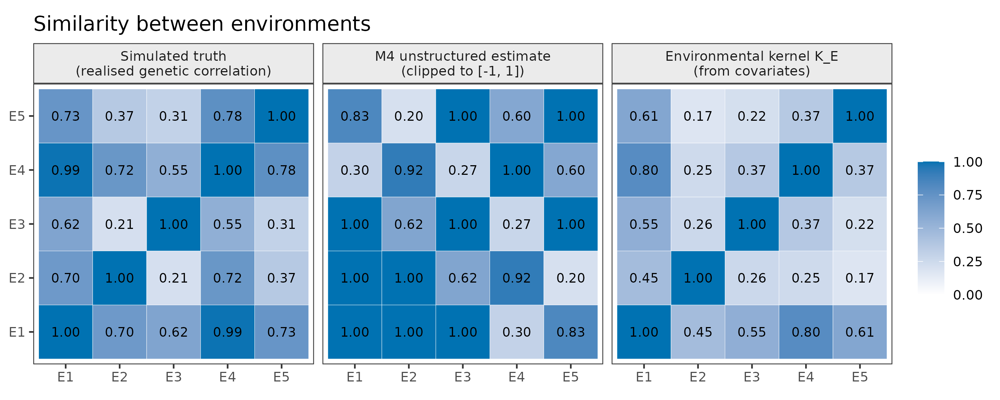
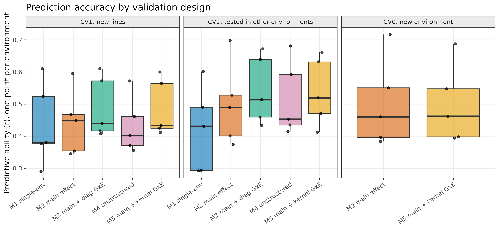
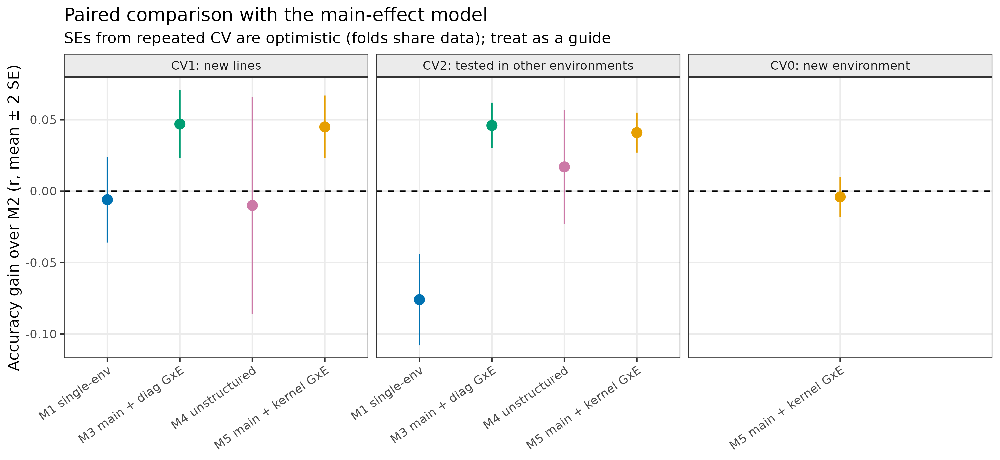

# Multi-Environment Genomic Prediction (single- vs multi-environment models)

A reproducible R workflow that compares single-environment and multi-environment genomic
prediction models, including genotype x environment (G x E) structures, under three
validation designs: new lines (CV1), lines tested in other environments (CV2), and a new
environment (CV0).

> **All data are simulated** (120 maize-like inbred lines, 5 environments). Results show
> that the workflow runs and illustrate methodological points. They are **not** evidence of
> performance on real breeding data. The panel is deliberately small because the mixed-model
> fits are slow (see Runtime).

## Scientific questions
1. Does borrowing information across environments improve genomic prediction over fitting each environment separately?
2. Does modelling G x E (diagonal, unstructured, or covariate-kernel) add accuracy beyond a genotype main effect?
3. Can an unseen environment be predicted, and do environmental covariates help?

## Models (all use the same VanRaden genomic relationship matrix **G**)
| ID | Model | Software |
|---|---|---|
| M1 | Single-environment GBLUP, one model per environment (no borrowing) | `rrBLUP::mixed.solve` |
| M2 | Across-environment, genotype main effect only | `sommer::mmes` |
| M3 | Main effect + environment-specific genomic variances (diagonal G x E) | `sommer::mmes` |
| M4 | Unstructured genetic covariance between environments | `sommer::mmes` |
| M5 | Main effect + G x E with an environmental-covariate kernel, **K**<sub>E</sub> ⊗ **G** | `sommer::mmes` |

Models M2-M5 include a fixed environment effect and a separate residual variance per environment.

## Validation designs
| Design | Question | Training / test |
|---|---|---|
| CV1 | Predict **new lines** | 5-fold over lines; test lines are absent from every environment |
| CV2 | Predict lines **tested elsewhere** | Random cells (line x environment) masked in 5 folds |
| CV0 | Predict a **new environment** | Leave one environment out; M1 cannot do this. M3/M4 have no covariance linking an unseen environment, so only M2 and M5 are evaluated |

Accuracy is the within-environment correlation between predicted and observed values
(*r*); in this simulation we also report the correlation with true genetic values
(*r*<sub>TGV</sub>). CV1 and CV2 use 5 folds x 2 repetitions (10 fits per model); CV0 uses 5 fits.

## Simulation design
Subpopulation structure (Balding-Nichols) and LD along chromosomes (Gaussian copula) are
simulated as in the companion repository `genomic-prediction-rrblup-gblup`. Causal-marker
effects are correlated across environments through a correlation matrix computed from the
first three of five environmental covariates, so a kernel from **all five** covariates is
informative but imperfect (correlation 0.76 with the realised genetic correlations).
Plot-level heritability ranges from 0.35 to 0.65 across environments.

## Quick start
```bash
git clone https://github.com/ravigenomeinfo/multi-environment-genomic-prediction.git
cd multi-environment-genomic-prediction
Rscript install_packages.R
Rscript tests/run_tests.R      # 17 unit tests
Rscript run_all.R              # full workflow
```
Scripts can also be run individually from the repository root, in order (`R/01_...` to `R/06_...`).
Settings (seed, sizes, QC, folds, repetitions) are in `config.R`.

**Software.** Developed and tested with R 4.3.3, `sommer` 4.4.1, `rrBLUP` 4.6.3 and
`ggplot2` 3.4.4. The code uses the `mmes()` / `vsm()` interface of `sommer` 4.4; other
versions may need syntax changes. The session is written to `results/session_info.txt`.

**Runtime.** About 10 minutes on a single CPU core. Mixed-model fit time grows steeply with
the number of observations (a 250-line version took over a minute per fit).

## Repository structure
```
├── config.R  run_all.R  install_packages.R
├── R/
│   ├── functions.R                  # simulation, QC, G, K_E, model fitting, metrics
│   ├── 01_generate_data.R
│   ├── 02_qc_genotypes.R
│   ├── 03_relationship_matrices.R   # G and environmental kernel K_E
│   ├── 04_fit_full_models.R         # fit on all data, genetic correlations
│   ├── 05_cross_validation.R        # CV1, CV2, CV0
│   ├── 05b_paired_comparison.R      # paired differences vs M2
│   └── 06_visualize_results.R
├── data/        (simulated inputs; see data/README.md)
├── results/{figures,tables}/
└── tests/
```

## Results (included run, seed 2026)
Mean predictive ability *r* (within-environment correlation; 10 fits per model for CV1/CV2, 5 for CV0):

| Design | M1 single-env | M2 main | M3 diag G x E | M4 unstructured | M5 kernel G x E |
|---|---|---|---|---|---|
| CV1: new lines | 0.436 | 0.442 | 0.489 | 0.432 | 0.487 |
| CV2: tested elsewhere | 0.422 | 0.498 | 0.544 | 0.515 | 0.539 |
| CV0: new environment | n/a | 0.502 | n/a | n/a | 0.498 |

Paired gain over M2 (mean ± SE over repetition x fold units; `results/tables/cv_paired_vs_M2.csv`):

| Design | M1 | M3 | M4 | M5 |
|---|---|---|---|---|
| CV1 | −0.006 ± 0.015 | +0.047 ± 0.012 | −0.010 ± 0.038 | +0.045 ± 0.011 |
| CV2 | −0.076 ± 0.016 | +0.046 ± 0.008 | +0.017 ± 0.020 | +0.041 ± 0.007 |
| CV0 | n/a | n/a | n/a | −0.004 ± 0.007 |





### Interpretation
- **Borrowing information across environments helps.** In CV2 the single-environment models (M1) were clearly worse than the across-environment main-effect model (−0.076).
- **G x E terms added about +0.045 in *r*** (M3, M5) over the main effect in CV1 and CV2, and won in all 10 units. The diagonal (M3) and covariate-kernel (M5) models performed alike here.
- **The unstructured model (M4) was not reliably better** and its genetic correlations were poorly estimated: on the full data its covariance matrix was not positive semi-definite (smallest eigenvalue about −0.2), some estimated correlations exceeded 1, and they did not track the simulated truth (`results/figures/fig04_correlation_recovery.png`). Estimating many free covariances from 120 lines is not feasible; M4 also had the lowest in-sample AIC, a reminder that in-sample fit is not predictive performance.
- **New-environment prediction (CV0):** the main-effect model and the covariate-kernel model gave the same accuracy. Prediction differed mainly by environment (E4 was easiest), not by model. The kernel correlated well with the true genetic correlations, yet it did not improve prediction with only 4 training environments, so no benefit is claimed.

## Limitations
- Simulated data only; LD and G x E come from simplified generating models, and the covariate kernel is partly built from the same covariates that generate the genetic correlations.
- One simulated dataset and one seed; small panel (120 lines, 5 environments); balanced design.
- Standard errors from repeated cross-validation are optimistic because folds share data.
- Single trait; additive effects only; no management factors (G x E x M is planned in a separate repository).
- The unstructured model needed a relaxed inversion tolerance to fit; its estimates are unreliable at this size.
- QC, imputation, **G** and **K**<sub>E</sub> are computed on all lines before cross-validation (no phenotypes are used, but a strict pipeline would recompute within folds).
- Fixed effects other than environment (blocks, trials) are not modelled.

## Ideas for future versions
Real public multi-environment data with a clear licence; more environments and lines with a faster
solver; factor-analytic G x E structures; additional covariates and reaction-norm models; unbalanced
designs; Bayesian alternatives (BGLR); GitHub Actions to run the tests.

## License and citation
MIT License (see `LICENSE`); citation metadata in `CITATION.cff`.
Key references: VanRaden (2008) *J Dairy Sci* 91:4414; Burgueño et al. (2012) *Crop Sci* 52:707;
Jarquín et al. (2014) *Theor Appl Genet* 127:595; Covarrubias-Pazaran (2016) *PLoS ONE* 11:e0156744 (sommer).
